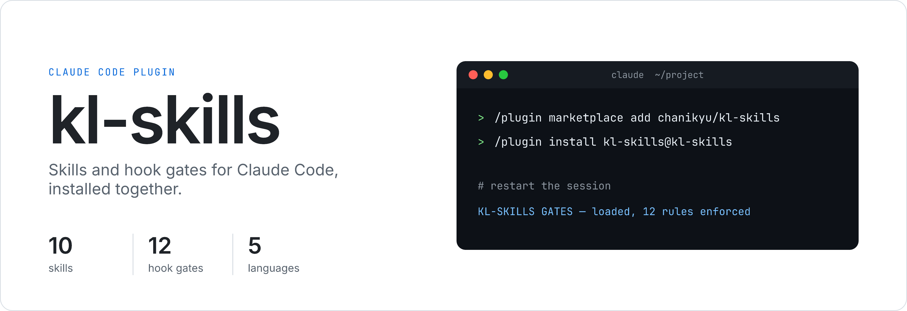
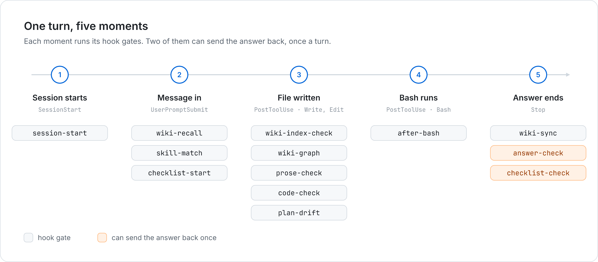
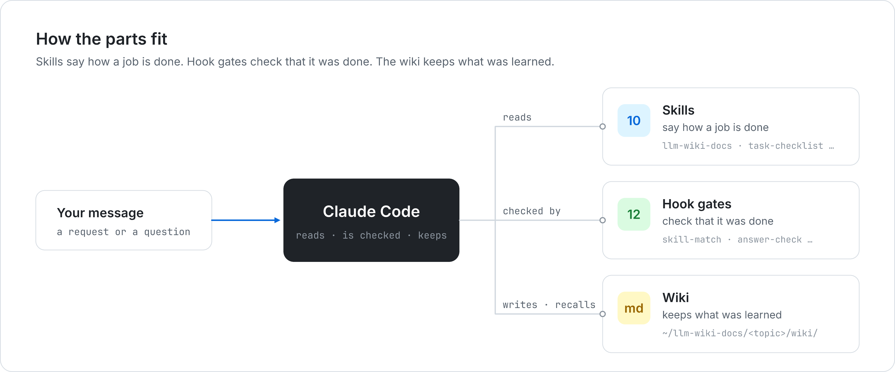

<div align="center">



<br />


<a href="../wiki/Home-es.md"></a>

[English](../../README.md) · [한국어](../ko-KR/README.md) · [日本語](../ja-JP/README.md) · [简体中文](../zh-CN/README.md) · **Español**

[Instalación](#instalación) · [Skills](#skills) · [Hook gates](#hook-gates) · [Wiki](../wiki/Home-es.md)

</div>

<br />

## De un vistazo

Claude Code olvida lo que aprendió cuando termina una conversación, y en una conversación larga se aleja de reglas como «escríbelo sencillo».

kl-skills guarda lo que Claude aprende en una wiki y lo recupera más tarde. Las reglas van en hooks que revisan cada turno.



| Incluye | Cantidad | Qué hace |
| --- | --: | --- |
| Skills | 10 | Wiki, respuestas claras, reglas de código, listas de comprobación, planificación, depuración, investigación |
| Hook gates | 12 | Elegir la skill, listas de comprobación, revisión de respuestas, mantenimiento de la wiki, revisión de textos y código |

<br />

## Instalación

```
/plugin marketplace add chanikyu/kl-skills
/plugin install kl-skills@kl-skills
```

Reinicia la sesión. La primera línea debería decir:

```
KL-SKILLS GATES v<version> — loaded, 12 rules enforced
```

> [!IMPORTANT]
> La mayoría de los gates están escritos en Python. Sin `python3`, se omiten en silencio.

> [!NOTE]
> Los mensajes de los gates y las reglas de escritura están pensados primero para el coreano. En español solo se revisan siglas sin definir y frases demasiado largas.

Requisitos, actualizar y desinstalar: [Instalación](../wiki/Installation-es.md).

<br />

## Skills



Cada nombre abre su página de la wiki: cuándo se aplica, qué decir y qué hace.

| Skill | Qué hace |
| --- | --- |
| [`llm-wiki-docs`](../wiki/llm-wiki-docs-es.md) | Guarda lo que aprendes en una wiki, una página por tema |
| [`wiki-recall`](../wiki/wiki-recall-es.md) | Busca páginas relacionadas de la wiki y las usa en la respuesta |
| [`graph-doc-memory`](../wiki/graph-doc-memory-es.md) | Dibuja toda la wiki como un grafo en el navegador |
| [`research-to-wiki`](../wiki/research-to-wiki-es.md) | Registra la investigación con el tipo de estudio de cada fuente y cuánto se leyó |
| [`natural-answering`](../wiki/natural-answering-es.md) | Escribe sin saltarse términos, puntos de comparación ni el paso hasta la conclusión |
| [`readable-code`](../wiki/readable-code-es.md) | Los nombres dicen qué contienen; los comentarios, por qué |
| [`no-hardcoding`](../wiki/no-hardcoding-es.md) | Mantiene listas, rutas y umbrales fuera del código |
| [`task-checklist`](../wiki/task-checklist-es.md) | Convierte cada instrucción en una lista de comprobación y solo termina cuando todos los puntos están hechos |
| [`planner`](../wiki/planner-es.md) | Planifica según el campo y el horizonte, y avisa del trabajo que se desvía del plan |
| [`pipeline-debug`](../wiki/pipeline-debug-es.md) | Busca la primera etapa que salió mal, no la línea que falló |

Una skill se carga cuando Claude juzga que la conversación encaja con su descripción, y eso no está garantizado. El gate `skill-match` nombra la skill adecuada en cada mensaje, y siempre puedes nombrarla tú.

<br />

## Hook gates

| Cuándo | Gate | Qué hace |
| --- | --- | --- |
| Empieza la sesión | `session-start` | Muestra el banner |
| Llega un mensaje | `wiki-recall` | Adjunta páginas relacionadas de la wiki |
| Llega un mensaje | `skill-match` | Nombra la skill que corresponde a este mensaje |
| Llega un mensaje | `checklist-start` | Dice dónde escribir la lista de comprobación de esta instrucción |
| Se escribe un archivo | `wiki-index-check` | Avisa de una página de la wiki que falta en el índice |
| Se escribe un archivo | `wiki-graph` | Vuelve a dibujar el grafo de la wiki |
| Se escribe un archivo | `prose-check` | Señala los puntos difíciles de leer en las páginas de la wiki |
| Se escribe un archivo | `code-check` | Señala nombres vagos de Python y docstrings que faltan |
| Se escribe un archivo | `plan-drift` | Revisa el marco del plan y sus desvíos |
| Se ejecuta Bash | `after-bash` | Detecta ediciones de la wiki y commits hechos en la shell |
| Termina la respuesta | `wiki-sync` | Pone el grafo al día, sin importar cómo se editaron las páginas |
| Termina la respuesta | `answer-check` | Revisa la respuesta y la devuelve una vez si hace falta |
| Termina la respuesta | `checklist-check` | Devuelve la respuesta una vez si queda un punto abierto en la lista |

Cuando un gate devuelve una respuesta, Claude Code muestra `Stop hook feedback:` con el motivo. Más en [Cómo funciona](../wiki/How-it-works-es.md).

<br />

## Novedades

- **0.23** — términos del campo: `answer-check` señala palabras que el campo no usa, en respuestas y diapositivas (`data/domain-terms.tsv`)
- **0.22** — `task-checklist` con sus dos gates, `skill-match` y esta wiki de documentación
- **0.21** — las skills de mantenimiento (`plugin-release`, `hook-replay`) salieron del plugin; README en cinco idiomas
- **0.20** — un turno que cambió archivos debe terminar con un informe de trabajo en seis pasos
- **0.19** — `hook-replay`, `plugin-release` y `research-to-wiki`
- **0.18** — bloquea solo cuando de verdad volviste a preguntar; desvíos del plan y búsqueda en la wiki

Historial completo: `git log`.

<br />

## Seguridad

- Los gates y los scripts de las skills no usan la red.
- La wiki, su grafo, tus planes y tus listas de comprobación se quedan en tu equipo.
- Cuando un gate no puede decidir, deja pasar el turno.

## Desarrollo

Publicar cambios, probar hooks con conversaciones reales, el contrato de salida de los hooks y el mapa de archivos: [docs/DEVELOPMENT.md](../DEVELOPMENT.md) (en inglés).

## Licencia

[MIT](../../LICENSE)
